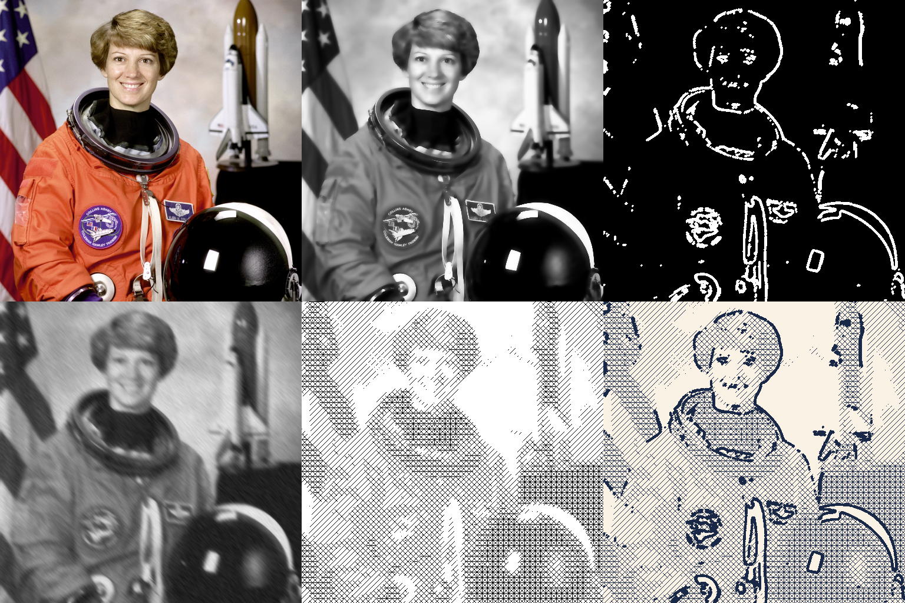

# Proyecto Integrador — Parte I: "Grabado a Plumilla" con OpenCL + VTK

**Visión Artificial · Computación · Oct 2026 – Feb 2027**
**Integrantes:** Angélica Panamá · José Ayala

Efecto artístico propio que convierte el video en un **grabado a plumilla (cross-hatching)**:
contornos a tinta + sombreado con líneas cruzadas cuya densidad depende del tono, sobre papel
crema. Se ejecuta con dos pipelines idénticos (CPU `cv::Mat` y GPU `cv::UMat` / OpenCL), en
**escritorio** (con el video como textura de un cubo 3D en VTK) y en **Android** (JNI + C++).


*Arriba: original, bilateral, bordes. Abajo: trazo (kernel propio), tramado, resultado final.*

---

## 1. Estructura

```
proyecto_integrador_p1/
├── common/
│   ├── plumilla_effect.hpp   ← EL EFECTO (compartido escritorio + Android)
│   └── sys_metrics.hpp       ← RAM y %CPU del proceso (Linux/Android/Windows/macOS)
├── desktop/
│   ├── main.cpp              ← cámara, trackbars, benchmark, cubo VTK (cv::viz)
│   └── CMakeLists.txt
├── android/                  ← proyecto Android Studio (Java UI + C++ por JNI)
│   ├── settings.gradle, build.gradle, gradle.properties
│   └── app/src/main/{AndroidManifest.xml, cpp/, java/, res/}
├── tools/
│   ├── plot_benchmark.py     ← gráficas para el informe a partir de los CSV
│   └── prototipo_efecto.py   ← el mismo efecto en Python (para explicar/afinar)
└── docs/etapas_efecto.png
```

---

## 2. Requisitos y compilación — ESCRITORIO

Se necesita OpenCV **4.x compilado con OpenCL y con el módulo `viz`** (está en *opencv_contrib*
y requiere VTK). Los paquetes de `pip` y la mayoría de paquetes del sistema **no** traen `viz`.

### Linux (Ubuntu/Debian) — recomendado
```bash
sudo apt install build-essential cmake git libvtk9-dev libgtk-3-dev \
                 ocl-icd-opencl-dev opencl-headers clinfo
# Drivers OpenCL según GPU: intel-opencl-icd | nvidia-driver-XXX | mesa-opencl-icd (AMD)
clinfo | head            # debe listar al menos una plataforma

git clone -b 4.10.0 https://github.com/opencv/opencv.git
git clone -b 4.10.0 https://github.com/opencv/opencv_contrib.git
cmake -S opencv -B opencv/build -DCMAKE_BUILD_TYPE=Release \
      -DOPENCV_EXTRA_MODULES_PATH=../opencv_contrib/modules \
      -DWITH_OPENCL=ON -DWITH_VTK=ON -DBUILD_opencv_viz=ON \
      -DBUILD_TESTS=OFF -DBUILD_PERF_TESTS=OFF -DBUILD_EXAMPLES=OFF
cmake --build opencv/build -j$(nproc)
sudo cmake --install opencv/build
```
Verificación: en la salida de `cmake` deben aparecer **`OpenCL: YES`** y **`viz`** en *To be built*.

### Windows
Instalar VTK (compilado con CMake o vcpkg: `vcpkg install vtk opencv4[contrib,vtk]`) y los
drivers de la GPU (traen OpenCL). Luego `cmake -DOpenCV_DIR=...` igual que abajo.

### Compilar y ejecutar
```bash
cd desktop && mkdir build && cd build
cmake .. -DCMAKE_BUILD_TYPE=Release        # o -DOpenCV_DIR=/ruta/opencv/build
cmake --build . -j
./plumilla_desktop            # cámara 0
./plumilla_desktop video.mp4  # archivo
```

### Controles (escritorio)
| Control | Qué hace |
|---|---|
| Trackbar **Kernel propio k** | tamaño del kernel de trazo (1→61). Es el que "satura" la CPU: costo O(k²) |
| Trackbar **Bilateral d** | ventana del filtro bilateral, también O(d²) |
| **Umbral bordes**, **Espaciado trama**, **Morfología** | ajustan la estética |
| Trackbar **Etapa** | qué etapa se ve en la cara frontal del cubo (Original → Final) |
| `m` | modo CPU / GPU / Ambos (comparativa en vivo) |
| `a` | rotación automática del cubo on/off (el mouse siempre lo rota; no se usa `k` porque en VTK exporta la escena a .obj) |
| `b` | **benchmark automático**: barre k = 3…61 y guarda `benchmark_sweep.csv` |
| `f` | invierte la textura si en su versión de VTK aparece al revés |
| `ESC` / `q` | salir |

El cubo muestra 6 caras: frente = etapa elegida, atrás = original, izquierda = bordes,
derecha = tramado, arriba = trazo, abajo = ecualizada. Las métricas salen en el HUD 3D y en la
ventana "Controles"; además cada frame se guarda en `benchmark_live.csv`.

**Demostrar consumo de GPU en vivo:** `nvidia-smi -l 1`, `sudo intel_gpu_top` o `radeontop`
(Linux); Administrador de tareas → Rendimiento → GPU (Windows); Monitor de Actividad → Ventana →
Historial de GPU (Mac M1). Cambien con `m` entre CPU y GPU y muestren cómo sube la GPU.

---

## 3. Compilación — ANDROID

1. Descargar **OpenCV Android SDK 4.10** desde https://opencv.org/releases y descomprimir.
2. En `android/gradle.properties` poner la ruta: `opencvsdk=/ruta/OpenCV-android-sdk`.
3. Abrir la carpeta `android/` en Android Studio, instalar **NDK** y **CMake 3.22.1**
   (SDK Manager → SDK Tools). Ajustar `ndkVersion` en `app/build.gradle` a la instalada.
4. Conectar el celular (depuración USB) y *Run*.

**Primero un "Hola mundo" JNI:** si es la primera vez, comenten el cuerpo de `nativeProcess`
y devuelvan el frame tal cual; cuando eso funcione, activen el efecto.

La app muestra **original | efecto** en pantalla dividida (switch), un selector de **etapa
intermedia**, selector de **modo CPU/GPU/Ambos**, SeekBars de kernel/bilateral/umbral/trama y
el panel de **ms CPU, ms GPU, speedup, FPS, RAM, %CPU** y el nombre del dispositivo OpenCL.

**OpenCL en el celular:** en el manifiesto se declara `<uses-native-library android:name="libOpenCL.so">`;
sin eso, desde Android 12 OpenCV no puede cargar el driver y el modo "GPU" corre en CPU. Si el
panel dice *"OpenCL NO disponible"*, el teléfono no expone OpenCL a apps (pasa en algunos
modelos): documéntenlo en el informe y prueben con otro celular (Adreno/Qualcomm y Mali suelen
funcionar).

Para la gráfica de Android: anoten los ms que muestra la app para k = 3, 7, 11, … 59 en un
`android_sweep.csv` con las columnas `kernel,bilateral_d,cpu_ms,gpu_ms,speedup,ram_mb`.

---

## 4. Gráficas para el informe
```bash
cd tools
python plot_benchmark.py --dir ../desktop/build --out ../docs/graficas
```
Genera: tiempo vs tamaño de kernel (CPU vs GPU), speedup, FPS por modo, RAM por modo, FPS en el
tiempo y `resumen_por_modo.csv`. Cubre los 3 puntos del informe (FPS, memoria, explicación).

---

## 5. Arquitectura (base para el diagrama del informe — Figura 4)

```mermaid
flowchart LR
    CAM[Cámara / video\nBGR 640x480] --> SEL{Modo}
    SEL -->|cv::Mat| CPU[Pipeline CPU\nRAM]
    SEL -->|copyTo → cv::UMat| GPU[Pipeline OpenCL\nVRAM]
    subgraph Pipeline Plumilla - mismo código plantilla
      G[Gris] --> EQ[1 Ecualización] --> BIL[2 Bilateral]
      BIL --> MED[Mediana] --> LAP[3 Laplaciano + umbral] --> MOR[4 Apertura + dilatación]
      BIL --> MIX[Tono + grano] --> K[5 Kernel propio 45°\nfilter2D] --> HAT[Tramado\ncompare/AND/OR/NOT]
      MOR --> COMB[Tramado AND NOT bordes]
      HAT --> COMB --> LUT[6 LUT tinta/papel]
    end
    CPU --> T1[chrono ms]
    GPU --> F[ocl::finish] --> T2[chrono ms]
    LUT --> VTK[Escritorio: textura WImage3D\nen cubo cv::viz rotando]
    LUT --> AND[Android: JNI → pantalla\noriginal | efecto]
    T1 & T2 --> MET[HUD + CSV:\nms, speedup, FPS, RAM, %CPU]
```

---

## 6. Matemática del efecto (para el informe y la defensa)

| # | Etapa | Fórmula / idea | Por qué |
|---|---|---|---|
| 1 | **Ecualización** | sₖ = (L−1)·Σⱼ≤ₖ p(rⱼ)  (CDF del histograma) | Reparte los niveles de gris; atenúa iluminación pobre o desigual |
| 2 | **Bilateral** | w(p,q) = G_σs(‖p−q‖)·G_σr(\|I_p−I_q\|) | Suaviza zonas planas sin borrar bordes (el peso cae si los píxeles son de distinto tono) |
| 3 | **Mediana + Laplaciano** | ∇²I = ∂²I/∂x² + ∂²I/∂y²; kernel [0 1 0; 1 −4 1; 0 1 0] | La mediana quita ruido impulsivo; el Laplaciano (2ª derivada) responde a cambios bruscos → contornos. Umbral sobre \|∇²I\| |
| 4 | **Morfología** | Apertura = erosión→dilatación; luego dilatación | La apertura elimina puntos sueltos; la dilatación engrosa la línea como un trazo de pluma |
| 5 | **Kernel propio** | ver abajo | Genera la textura de trazo diagonal |
| 5b | **Tramado** | tinta = ⋃ᵢ [(trazo < Tᵢ) ∧ patrónᵢ] | Más oscuro ⇒ más capas de líneas (45°, −45°, horizontal, vertical) |
| 6 | **LUT** | c(v) = tinta + (papel − tinta)·v/255 | Interpolación lineal punto a punto: blanco→crema, negro→tinta azul-sepia |

### Kernel propio: gaussiano anisotrópico orientado a 45°
Para un kernel k×k con coordenadas centradas x, y ∈ [−c, c], c = (k−1)/2:

- Rotación 45°: **u = (x + y)/√2** (a lo largo del trazo), **v = (x − y)/√2** (a través)
- **K(x,y) = exp(−u²/2σᵤ² − v²/2σᵥ²) / ΣK**, con σᵤ = k/4 (largo) y σᵥ = max(0.6, k/24) (angosto)

Propiedades que deben saber explicar:
- **ΣK = 1** → conserva el brillo medio (es un pasa-bajos, como el gaussiano normal).
- Es **anisotrópico**: difumina mucho en la dirección u y casi nada en v. Aplicado al *grano*
  (ruido aleatorio fijo, semilla 7) mezclado con el tono, el ruido se "estira" en rayas a 45°,
  que parecen trazos de lápiz. Si σᵤ = σᵥ sería un gaussiano isotrópico común.
- **Costo O(k²) por píxel** → por eso es el control para saturar el procesamiento.
- Matiz para la defensa: con kernels ≥ 11×11, `cv::filter2D` en CPU puede usar internamente una
  convolución por **DFT** (teorema de convolución), así que el tiempo de CPU no crece exactamente
  como k². Lo que se observa en la gráfica es real; esta es la explicación.

### Por qué la GPU es más rápida (y cuándo no)
Cada píxel de salida de una convolución es independiente → paralelismo masivo (miles de hilos
en la GPU vs pocos núcleos en la CPU). Pero la GPU paga la **transferencia RAM→VRAM**
(`copyTo` al `UMat`) y la **compilación de los kernels OpenCL en el primer frame**. Con kernels
pequeños esa sobrecarga puede hacer que la GPU no gane; al crecer k la ganancia aumenta. Eso es
justamente lo que debe verse en la gráfica de speedup.

### Detalle clave de medición
`cv::UMat` es **asíncrono**: las operaciones se encolan en la GPU y la función retorna antes de
que terminen. Por eso `timeGpu()` llama a `cv::ocl::finish()` antes de detener `std::chrono`.
Sin eso medirían tiempos falsamente bajos. El tiempo de GPU incluye la subida RAM→VRAM.

### Del 2D al 3D (VTK)
Cada cara del cubo es un `viz::WImage3D` (un plano con textura). Su pose global es
**P_global = P_cubo · P_cara**, donde P_cara = [R_cara | R_cara·(0,0,h)] coloca el plano a
distancia h = lado/2 del centro con la orientación de esa cara, y P_cubo es la rotación que
cambia en cada frame (vector de Rodrigues). Es una composición de transformaciones afines 3D.

---

## 7. Preguntas probables en la defensa (practíquenlas los dos)

1. *¿Por qué el bilateral y no un gaussiano?* — Preserva bordes por el término de rango G_σr.
2. *¿Qué hace `ocl::finish()` y qué pasa si lo quitan?* — Sincroniza; sin él los ms de GPU salen falsos.
3. *¿Por qué la primera ejecución en GPU es lenta?* — Compilación JIT de los kernels OpenCL.
4. *¿Diferencia entre `cv::Mat` y `cv::UMat`?* — Mat vive en RAM y procesa la CPU; UMat puede vivir en memoria del dispositivo OpenCL y OpenCV despacha a kernels OpenCL de forma transparente.
5. *Expliquen su kernel.* — Sección 6: fórmula, ΣK = 1, anisotropía, O(k²).
6. *¿Por qué Laplaciano y no Sobel?* — Una sola pasada, isotrópico (detecta bordes en todas las direcciones), segunda derivada → cruces por cero; sensible al ruido, por eso va después de mediana y bilateral.
7. *¿Qué es la apertura morfológica?* — Erosión seguida de dilatación: elimina objetos menores que el elemento estructurante sin encoger los grandes.
8. *¿Cómo funciona el tramado?* — `compare` crea una máscara de píxeles más oscuros que Tᵢ; `AND` con el patrón deja solo las líneas en esas zonas; `OR` acumula capas; `NOT` invierte para tinta negra sobre papel blanco.
9. *¿Por qué los buffers son miembros de la clase?* — Evita reservar memoria cada frame (en GPU eso costaría mucho).
10. *¿Cómo calculan la RAM?* — `VmRSS` de `/proc/self/status` (Linux/Android), `GetProcessMemoryInfo` (Windows).
11. *¿Cómo se coloca cada cara del cubo?* — Composición de afines (sección 6).
12. *¿Cómo llega el frame de Java a C++?* — `getNativeObjAddr()` pasa el puntero del `cv::Mat`; en C++ se castea con `reinterpret_cast<cv::Mat*>`, sin copiar.

**Reparto sugerido** (para que ambos sepan todo, pero cada uno lidere algo):
- **Angélica:** efecto y matemática (`plumilla_effect.hpp`, sección 6), gráficas e informe.
- **José:** escritorio + VTK (`main.cpp`), Android/JNI, benchmark y demo en vivo.
- **Ambos:** practicar las 12 preguntas y el video en inglés. El factor de sustentación es individual.

---

## 8. Checklist contra la rúbrica

| Criterio | Dónde se cumple |
|---|---|
| Arquitectura multiplataforma (20%) | `desktop/` + `android/` comparten `common/plumilla_effect.hpp`; OpenCL en ambos |
| Calidad y diseño del efecto (25%) | 4 filtros de clase (ecualización, bilateral, Laplaciano/mediana, morfología) + kernel propio con `filter2D` + manipulación de píxeles (patrones, LUT, AND/OR/NOT) |
| Benchmark OpenCL (25%) | `Mat` vs `UMat`, trackbars/SeekBars de kernel y bilateral, ms en pantalla, barrido `b` |
| Integración 3D VTK (30%) | cubo `WImage3D` rotando, interactivo con mouse; Android muestra original + efecto + etapas |
| Informe: FPS, memoria, matemática | `tools/plot_benchmark.py` + secciones 5–6 |

---

## 9. Uso de IA y código de terceros (inclúyanlo en el informe)

La guía exige citar el código generado con LLMs y entenderlo. Declaración sugerida:

> El código base de este proyecto fue generado con asistencia de **Claude (Anthropic)** a partir
> de la guía del proyecto integrador. Prompt principal: *"Resuelve la Parte I del proyecto
> integrador [guía adjunta]: efecto artístico propio con pipeline CPU (cv::Mat) y GPU (cv::UMat),
> app de escritorio con VTK y app Android con JNI"*. Los integrantes revisaron, compilaron,
> probaron y ajustaron el código, y pueden explicar cada línea.

Referencias útiles para citar:
- OpenCV Team, *OpenCV 4.x documentation: cv::UMat y Transparent API (T-API)*, https://docs.opencv.org/4.x/
- OpenCV Team, *opencv_contrib: módulo viz (3D Visualizer basado en VTK)*, https://github.com/opencv/opencv_contrib
- C. Tomasi y R. Manduchi, "Bilateral filtering for gray and color images," ICCV 1998.
- R. C. Gonzalez y R. E. Woods, *Digital Image Processing*, 4ª ed., Pearson, 2018 (ecualización, Laplaciano, morfología).
- M. P. Salisbury et al., "Interactive pen-and-ink illustration," SIGGRAPH 1994 (inspiración del tramado).
- Imagen de prueba `docs/etapas_efecto.png`: fotografía de la astronauta Eileen Collins (NASA, dominio público), incluida en scikit-image.
